# Manual del CRM EspacioVital

Este manual explica, paso a paso y con fotos, cómo usar el CRM en el día a día: registrar clientes, llevar sus expedientes, atender las citas que llegan del sitio web, hacer videollamadas, cobrar y pedir datos o fotos con formularios.

Está escrito para quien atiende, no para quien programa. Las fotos son del sistema real; los nombres, correos y datos de las personas son de ejemplo. Los números que ves sobre las fotos corresponden a la lista que está debajo de cada una.

## 1. Cómo entrar y moverse por el sistema

Abre la dirección del CRM en el navegador (de la computadora o del celular), escribe tu correo y tu contraseña y pulsa **Entrar**.

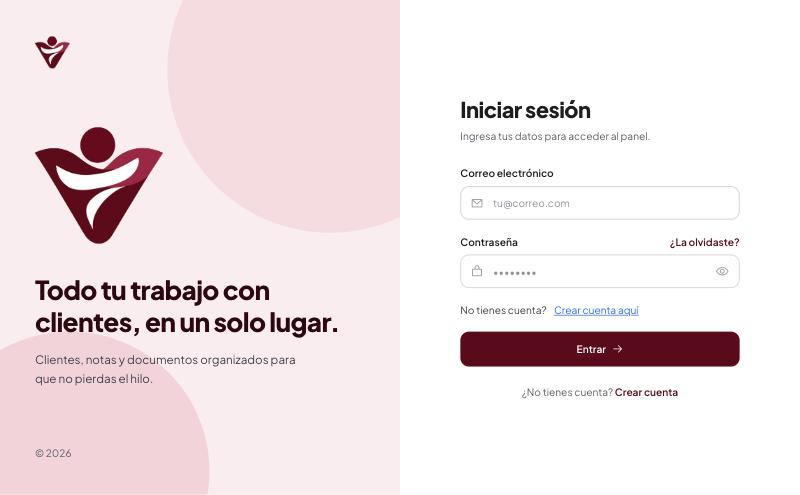
*Pantalla de inicio de sesión.*

1. Correo electrónico con el que te registraron.
2. Contraseña. El ojo de la derecha te deja ver lo que escribes.
3. Botón Entrar.

Al entrar llegas al **Dashboard**. En todas las pantallas encuentras lo mismo:

- **Menú lateral (izquierda):** Dashboard, Agenda, Clientes, Notas, Biblioteca, Formularios y Reuniones. En el celular se abre con el botón de las tres rayas, arriba a la izquierda.
- **Buscador y campana (arriba):** el buscador está para encontrar clientes, notas y archivos.
- **Dos botones flotantes (abajo a la derecha):** el amarillo con la chincheta abre tus recordatorios y el rojo con el lápiz abre una nota nueva. Están en todas las páginas.

> **Consejo.** Si algo no se ve como esperas después de una mejora del sistema, recarga la página (en la computadora, Cmd+Shift+R o Ctrl+Shift+R). En el celular, cierra la pestaña y vuelve a abrirla.

## 2. Dashboard: tu resumen del día

Es la pantalla de inicio. Te da una mirada rápida de cómo va todo, sin tener que abrir nada.

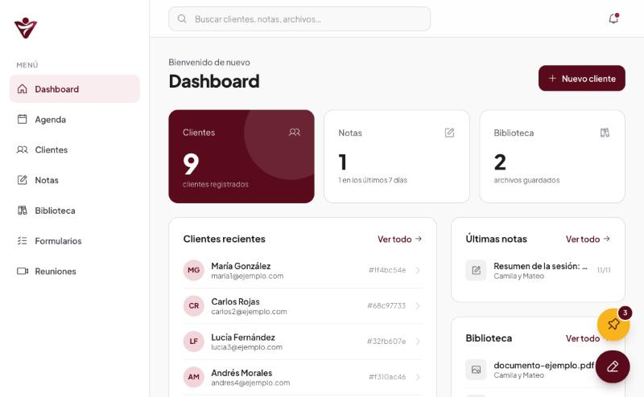
*El Dashboard con el resumen, los clientes recientes y los botones flotantes.*

1. Menú lateral: desde aquí vas a cada sección.
2. Nuevo cliente: abre el formulario para registrar a alguien.
3. Tarjetas de resumen: cuántos clientes tienes, las notas de los últimos 7 días y los archivos guardados.
4. Burbuja amarilla de recordatorios. El número rojo indica cuántos tienes pendientes.
5. Botón rojo: escribe una nota nueva desde cualquier página.

- Abajo ves tus **clientes más recientes**, tus **últimas notas** y los **últimos archivos** subidos. Toca cualquiera para abrirlo.
- Cuando guardas una nota con el botón rojo, el resumen se actualiza solo.

### Recordatorios (la burbuja amarilla)

Es una libreta para anotar cosas rápidas: llamar a alguien, enviar un formulario, revisar un pago. Está en todas las páginas.

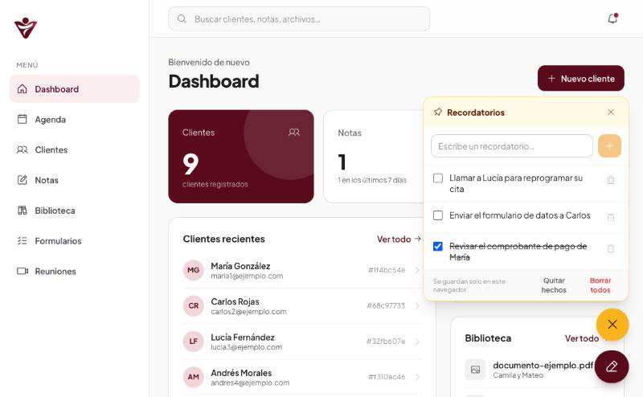
*El panel de recordatorios abierto.*

1. Escribe aquí y pulsa Enter (o el botón +) para agregarlo.
2. Marca la casilla cuando lo hagas. Se tacha y desaparece solo a las 24 horas.
3. Quitar hechos borra los que ya marcaste; Borrar todos limpia la lista completa.

> **Importante.** Los recordatorios se guardan **solo en ese navegador**. No se ven en otro dispositivo ni en otro navegador, y se pierden si se borran los datos del navegador. Es una libreta temporal, no un registro permanente.

## 3. Clientes

Aquí está la lista de todas las personas que atiendes. Una **pareja aparece en una sola fila**, con las iniciales de las dos personas.

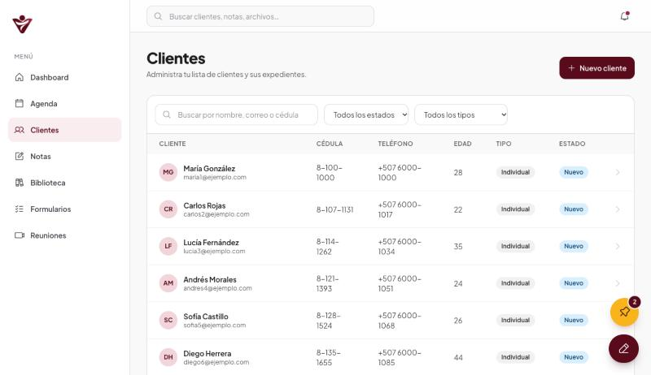
*La lista de clientes con la columna de estado.*

1. Buscador: escribe un nombre, un correo o una cédula.
2. Filtros por estado (nuevo, activo, inactivo) y por tipo (individual, pareja, niños y adolescentes).
3. Nuevo cliente.
4. Estado del cliente, calculado por el sistema.

Para abrir el expediente de alguien, toca su fila o su nombre.

### Registrar un cliente nuevo

1. Pulsa **Nuevo cliente** (en el Dashboard o en la lista de clientes).
2. Llena nombre, apellido, correo, cédula, teléfono, edad y tipo de atención.
3. Si el tipo es **pareja**, aparecen los campos de la segunda persona. Las dos quedan ligadas: comparten notas, archivos, reuniones y cobros.
4. Pulsa **Guardar**. Se crea su expediente automáticamente.

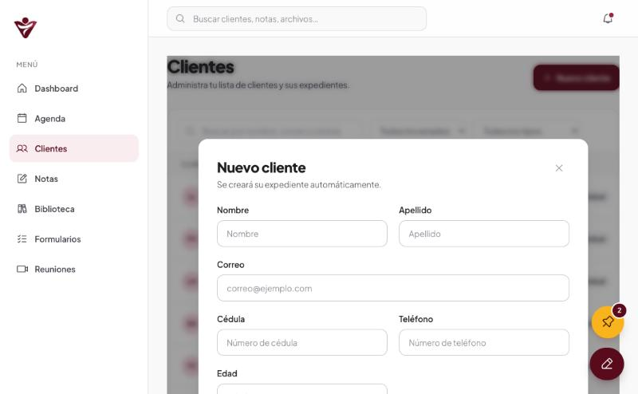
*El formulario de nuevo cliente.*

1. Nombre y apellido. Los datos de contacto van más abajo.

> **Consejo.** La cédula identifica a la persona. Si intentas registrar a alguien con una cédula que ya existe, el sistema te avisa y no lo duplica.

### Estados de los clientes

El sistema calcula solo el estado de cada cliente y lo muestra con una etiqueta de color. Al pasar el cursor sobre la etiqueta ves cuántas notas y citas tiene y su última actividad.

| Estado | Cuándo se asigna |
|---|---|
| Inactivo | Pasó un mes (30 días) sin actividad: ni notas, ni citas, ni reuniones, ni archivos nuevos. |
| Activo | Tiene 6 o más notas y ya tuvo 5 o más citas. |
| Nuevo | Todos los demás: hasta 5 notas, o todavía no llega a 5 citas. |

Primero se revisa si el cliente está inactivo; solo si no lo está se mira si cumple lo de activo. Una pareja cuenta como un solo cliente.

## 4. El expediente de un cliente

Es la ficha completa de la persona (o de la pareja). Arriba ves su nombre, tipo y estado; abajo, las pestañas con todo lo que tiene.

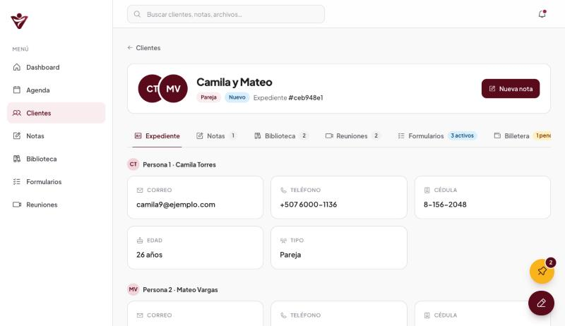
*El expediente de una pareja, pestaña Expediente.*

1. Nombre, tipo (Pareja) y estado (Nuevo) del cliente.
2. Nueva nota para este cliente.
3. Pestañas: Expediente, Notas, Biblioteca, Reuniones, Formularios y Billetera. Los números indican cuántos elementos tiene cada una.
4. Datos de cada persona: correo, teléfono, cédula, edad y tipo.

En una pareja, el expediente muestra los datos de **las dos personas** y todo lo demás (notas, archivos, reuniones, cobros) se comparte.

### Notas

Las notas son el registro de cada sesión. Puedes escribir una desde la pestaña **Notas** del expediente, o desde cualquier página con el **botón rojo del lápiz**.

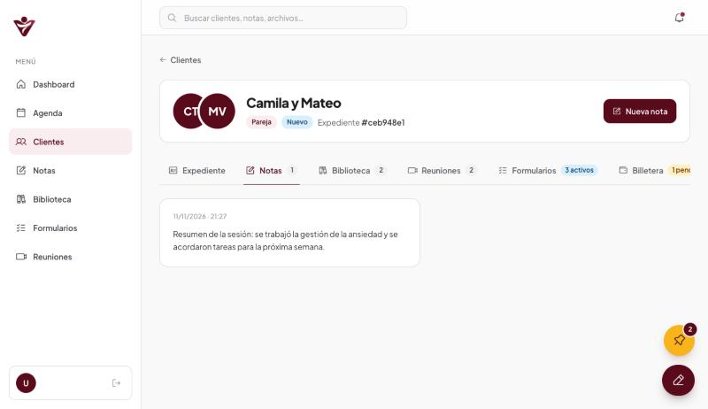
*La pestaña Notas con las notas del cliente, de la más reciente a la más antigua.*

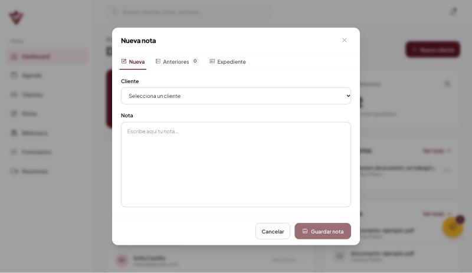
*La ventana de nueva nota, que se abre con el botón rojo.*

1. Tres pestañas: Nueva (escribir), Anteriores (las notas del cliente) y Expediente (sus datos y archivos).
2. Elige el cliente. Si estás dentro de su expediente, ya viene elegido.
3. Guardar nota.

Las notas de una pareja se guardan juntas: las dos personas comparten el mismo historial.

### Biblioteca

Es donde viven los archivos del cliente: informes, fotos, documentos. En la pestaña **Biblioteca** arrastra los archivos al recuadro punteado o pulsa **selecciónalos**. Cada archivo puede pesar hasta **4 MB**.

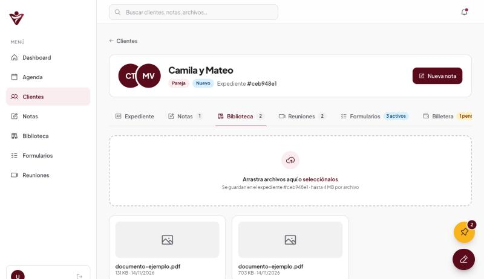
*La pestaña Biblioteca con sus archivos.*

1. Arrastra aquí tus archivos, o pulsa para elegirlos.

> **Consejo.** Los archivos que un cliente sube desde un formulario también llegan a esta Biblioteca. Para abrir un archivo, tócalo: se abre en una pestaña nueva.

### Reuniones

La pestaña **Reuniones** guarda el historial de videollamadas del cliente y te deja crear una nueva. Cómo funcionan las videollamadas se explica en la sección 5.

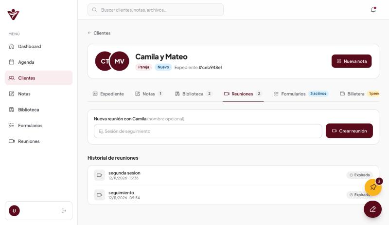
*La pestaña Reuniones con el historial de videollamadas.*

1. Crear reunión: genera la videollamada. Si quieres, ponle un nombre antes.
2. Las reuniones que pasaron de 3 horas aparecen como Expiradas y ya no se pueden abrir.

## 5. Videollamadas

Las videollamadas ocurren dentro del CRM: **no necesitas instalar nada ni usar otra plataforma**. La otra persona entra desde el celular o la computadora con solo abrir un enlace.

### Crear y compartir una reunión

1. Abre el expediente del cliente, pestaña **Reuniones**, escribe un nombre (opcional) y pulsa **Crear reunión**. También puedes hacerlo desde el menú **Reuniones**.
2. Pulsa **Copiar enlace** y envíaselo a la persona por WhatsApp o correo.
3. Pulsa **Entrar** para unirte tú. Antes de entrar ves tu cámara: revisa que se vea bien y pulsa **Entrar ahora**.

Si confirmas una cita virtual desde la Agenda, el sistema crea la reunión por ti y la incluye en el correo de confirmación.

### Durante la llamada

- Los botones de abajo apagan o encienden el micrófono y la cámara, comparten tu pantalla y salen de la llamada.
- Tu propio recuadro no reproduce tu voz. Si oyes eco, usa audífonos.
- El botón del lápiz abre un **panel lateral** sin tapar el video, con tres pestañas: **Nueva** (escribir una nota), **Anteriores** (las notas del cliente) y **Expediente** (sus datos y archivos). Así tienes todo a mano mientras atiendes.
- La imagen se envía en alta definición. Si la conexión de alguien es débil, el navegador baja la calidad solo.
- Si una persona está en datos móviles y no se conecta, el sistema usa un servidor de apoyo automáticamente.

### Vigencia del enlace

Un enlace de reunión sirve **3 horas desde que se crea**. Pasado ese tiempo, quien lo abra ve el mensaje "Esta reunión ya expiró" y en las listas aparece la marca **Expirada**. Las reuniones que se crean al confirmar una cita sirven hasta 3 horas después de que empieza la cita. Quien ya está dentro de la llamada puede seguir hasta que salga.

## 6. Agenda: las citas de tu sitio web

Las personas piden cita desde el sitio web (espaciovitalpsic.site/agendar) y sus solicitudes aparecen solas en la **Agenda**. Desde aquí las confirmas, las cancelas, las cierras y creas citas a mano. No necesitas usar ningún otro panel.

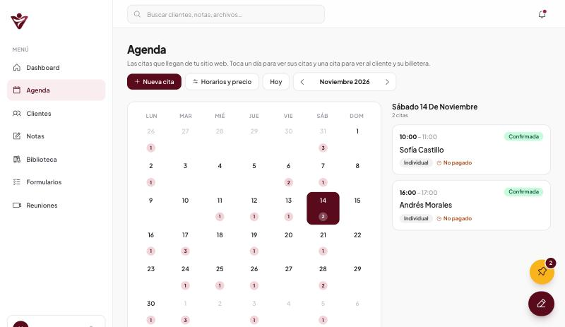
*La Agenda: el calendario del mes y las citas del día elegido.*

1. Nueva cita: para citas que acuerdas por teléfono o WhatsApp.
2. Horarios y precio: lo que las personas ven al agendar en tu sitio web.
3. Cambiar de mes (flechas) o volver al día de hoy.
4. Cada día muestra cuántas citas tiene. Toca un día para ver sus citas.
5. Las citas del día: hora, nombre, tipo, estado y si está pagada.

### Estados de una cita

| Estado | Qué significa |
|---|---|
| Solicitada | La persona la pidió y falta que la confirmes. |
| Confirmada | Ya está aceptada. La persona recibió su correo de confirmación. |
| Completada / No asistió | Se marcan cuando la cita ya empezó. |
| Cancelada | Se muestra tachada y atenuada. |

### Confirmar una cita

Toca la cita solicitada para abrir su detalle.

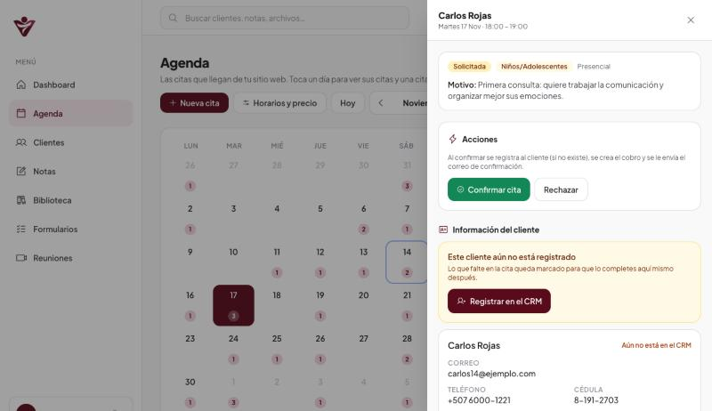
*El detalle de una cita solicitada.*

1. Confirmar cita: acepta la cita y hace todo lo demás por ti.
2. Rechazar: cancela la solicitud, con un motivo.
3. Registrar en el CRM: si la persona todavía no es cliente.

Si la cita es virtual puedes escribir un enlace de videollamada; si lo dejas vacío, el sistema usa el general de tu agenda o crea una sala del CRM ligada al cliente. Al pulsar **Confirmar cita** pasan cuatro cosas:

1. Se **registra al cliente** en el CRM si todavía no existía.
2. Se **crea el cobro** de la cita en su billetera, con el precio de tu agenda.
3. Se prepara el **enlace de la videollamada** (si la cita es virtual).
4. La persona recibe un **correo de confirmación** con la fecha, la hora, el enlace y el precio.

### Clientes que todavía no están registrados

Si la persona de una cita todavía no es cliente, aparece el recuadro amarillo con el botón **Registrar en el CRM**. Si a la cita le faltan datos (por ejemplo la cédula), igual se registra: lo que falte queda marcado como **Falta** y lo completas con **Editar datos** en la misma cita.

> **Importante.** Mientras el correo de una persona sea provisional (termina en @sin-correo.invalid), el sistema no le envía correos. Complétalo con Editar datos.

### Otras acciones de una cita confirmada

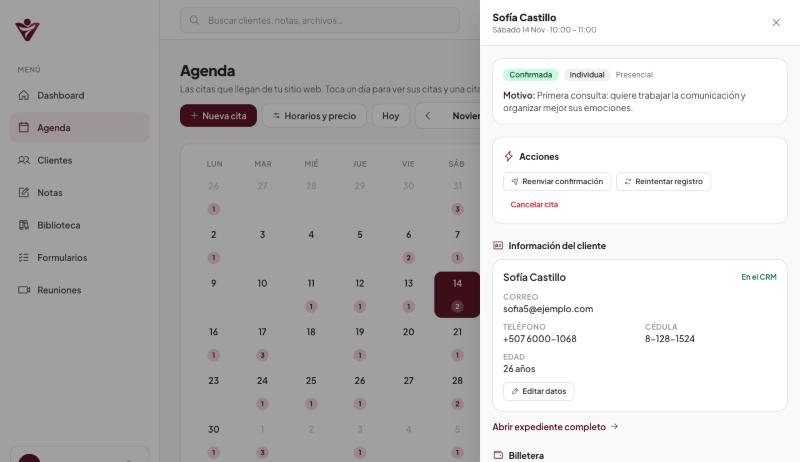
*El detalle de una cita ya confirmada.*

1. Acciones disponibles según el estado de la cita.
2. Reenviar confirmación: vuelve a enviar el correo.
3. Reintentar registro: repite el registro del cliente y el cobro si algo falló.
4. Cancelar cita: pide un motivo y avisa a la persona por correo.
5. Editar datos: completa lo que faltaba (cédula, teléfono, correo, edad).

- **Marcar completada** y **No asistió** aparecen cuando la cita ya empezó.
- **Cambiar enlace** permite poner otro enlace de videollamada.
- **Cancelar cita** pide el motivo, que la persona verá en su correo. Si la cita tenía un cobro sin pagar, el cobro se elimina.

### Nueva cita (a mano)

Para citas que acuerdas por teléfono, por WhatsApp o en persona. Pulsa **Nueva cita**.

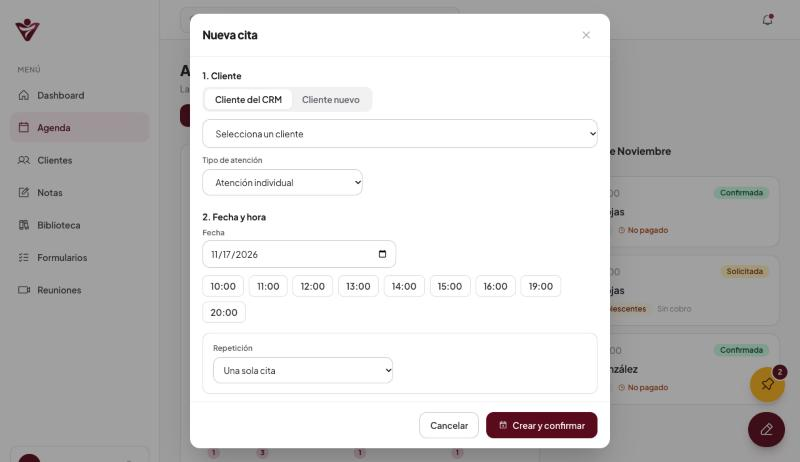
*La ventana Nueva cita: cliente, fecha y hora.*

1. Elige un cliente del CRM (sus datos se rellenan solos) o escribe uno nuevo. Solo el nombre es obligatorio.
2. Las horas libres del día, según tu horario. Toca la que quieras.
3. Repetición: una sola cita, cada semana, cada 2 semanas (de 2 a 12 citas) o varios días elegidos a mano.

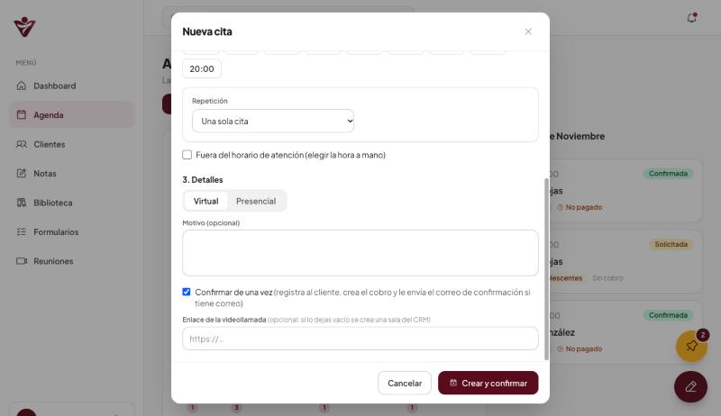
*La segunda parte de la ventana: detalles y confirmación.*

1. Fuera del horario de atención: si necesitas una hora que no está en tu horario, márcalo y escribe la hora. Solo se comprueba que no choque con otra cita.
2. Virtual o presencial.
3. Confirmar de una vez: registra al cliente, crea el cobro y envía el correo de confirmación.

- Con **repetición**, las fechas ocupadas se omiten y el sistema te avisa cuántas fueron.
- Con **Confirmar de una vez** y varias fechas, todas comparten el mismo enlace de videollamada y la persona recibe **un solo correo** con todas las fechas.

### Horarios y precio

El botón **Horarios y precio** controla lo que las personas ven al agendar en tu sitio web. **Lo que cambies aquí se refleja en la web al instante.**

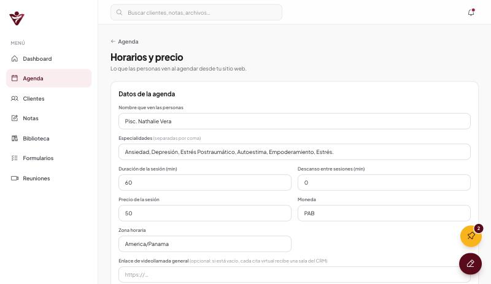
*Los datos de la agenda.*

1. Duración de la sesión en minutos.
2. Precio de la sesión. Es el que se usa para los cobros de las citas.
3. Zona horaria de tu agenda.

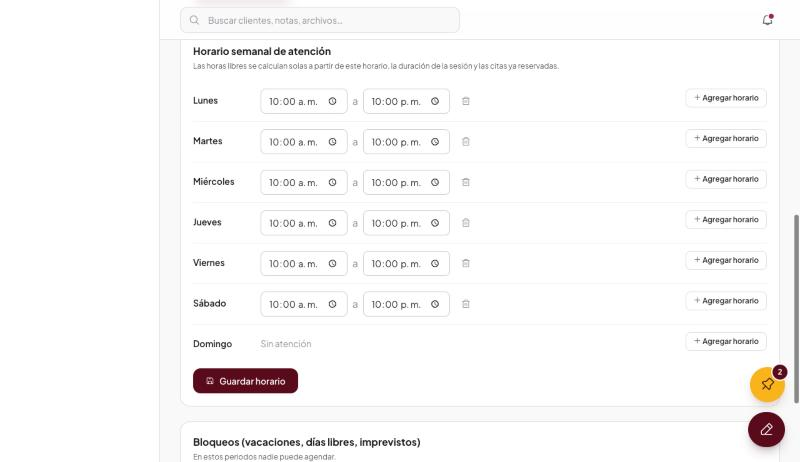
*El horario semanal de atención.*

1. El rango de horas de cada día. Las horas libres se calculan solas a partir de aquí.
2. Agregar horario: para tener más de un rango en el mismo día (por ejemplo mañana y tarde).
3. Guardar horario: no te olvides de pulsarlo.

- **Datos de la agenda:** nombre, especialidades, duración, descanso entre sesiones, precio, moneda, zona horaria, enlace de videollamada general y si la agenda está abierta al público.
- **Horario semanal:** los rangos de atención de cada día.
- **Bloqueos:** periodos en los que nadie puede agendar (vacaciones, días libres, imprevistos). Elige desde y hasta y pulsa **Crear bloqueo**.

> **Consejo.** Para evitar abusos, un mismo correo puede tener como máximo 3 solicitudes pendientes. Si alguien ve "Ya tienes varias citas pendientes", debe esperar la confirmación o escribirte. Tú puedes confirmar o cancelar esas citas desde la Agenda.

## 7. Billetera: cobros, pagos y facturas

Cada cliente tiene su billetera, en la pestaña **Billetera** del expediente. Arriba ves cuánto ha pagado y cuánto debe; abajo, el historial de cobros.

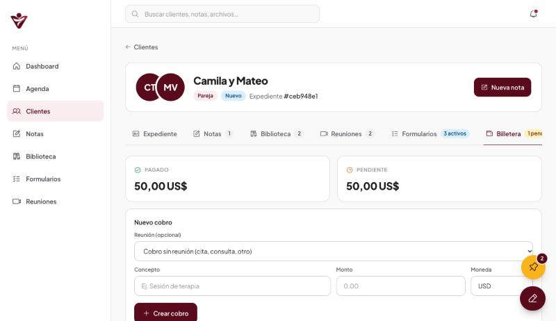
*La pestaña Billetera: totales y el formulario de nuevo cobro.*

1. Pagado y Pendiente: los totales del cliente.
2. Nuevo cobro: para cobros que no vienen de una cita.

Los **cobros de las citas se crean solos** al confirmar la cita. Para crear uno a mano, elige una reunión sin cobro (opcional), escribe el concepto, el monto y la moneda, y pulsa **Crear cobro**.

### Registrar un pago y enviar la factura

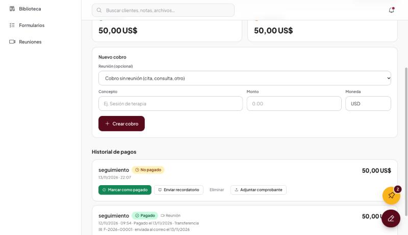
*El historial de cobros, con sus botones.*

1. Estado del cobro: No pagado o Pagado.
2. Marcar como pagado.
3. Enviar recordatorio de pago por correo.
4. Adjuntar comprobante: la foto o el PDF del pago.

1. En un cobro no pagado, pulsa **Marcar como pagado**.
2. Elige el método de pago (efectivo, transferencia, tarjeta u otro) y, si quieres, una referencia (por ejemplo el número de transferencia).
3. Pulsa **Confirmar pago y enviar factura**.

El sistema genera el número de factura y se la envía por correo al cliente (a las dos personas si es pareja). Puedes volver a enviarla con **Reenviar factura**.

### Recordatorio de pago y comprobante

- **Enviar recordatorio:** en un cobro no pagado, le manda al cliente un correo recordándole el pago. El cobro guarda cuántos recordatorios se enviaron y cuándo fue el último.
- **Adjuntar comprobante:** guarda la foto o el PDF del pago (hasta 4 MB). **Ver comprobante** lo abre.

> **Importante.** Estos correos salen con la cuenta de correo del sistema. Si el cliente no tiene un correo válido, el sistema te lo avisa en vez de enviarlo.

## 8. Formularios para tus clientes

Los formularios sirven para que un cliente **llene sus datos y suba fotos o documentos desde su celular, sin crear una cuenta**. Tú creas el formulario, generas su URL y se la envías. Lo que la persona responda y las fotos que suba se guardan en **su propio expediente**.

Hay dos formas de trabajar: con **plantillas generales** (lo más cómodo, porque las creas una vez y las reutilizas) o creando un formulario solo para un cliente.

### Plantillas generales (menú Formularios)

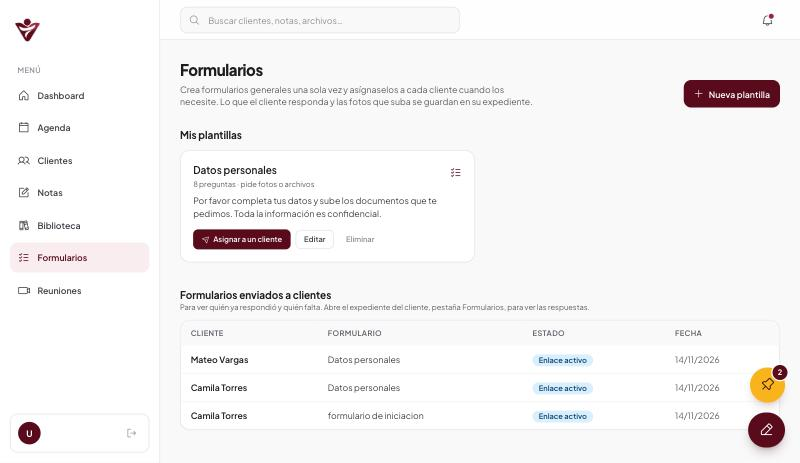
*El menú Formularios: tus plantillas y el seguimiento de lo que enviaste.*

1. Nueva plantilla.
2. Asignar a un cliente: crea el formulario de esa persona con su URL.
3. Seguimiento: a quién enviaste cada formulario y si ya respondió.

1. Entra al menú **Formularios** y pulsa **Nueva plantilla**.
2. Ya viene con las preguntas de datos más comunes (nombre, cédula, nacimiento, teléfono, correo, dirección y contacto de emergencia) y, al final, una pregunta para **subir fotos o documentos**.
3. Ajusta lo que necesites y pulsa **Crear plantilla**.

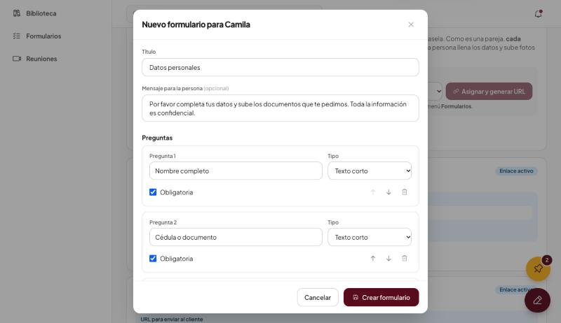
*El constructor de formularios: título, mensaje y preguntas.*

1. Título y mensaje que verá la persona.
2. Tipo de cada pregunta: texto, número, fecha, correo, teléfono, opciones, sí o no, o adjuntar archivos.
3. Obligatoria: la persona no puede enviar el formulario sin responderla.

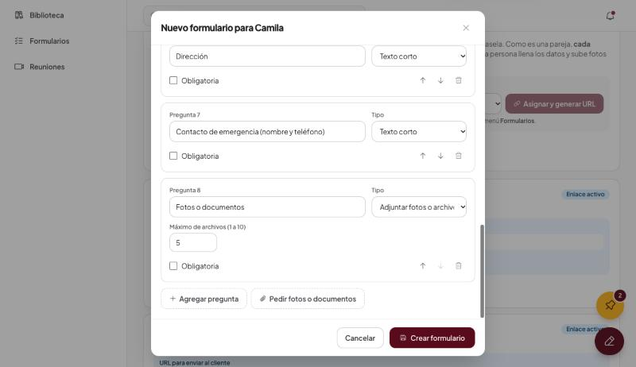
*El final del constructor: agregar preguntas y pedir fotos o documentos.*

1. Para las preguntas de archivos, el máximo de archivos que puede subir (de 1 a 10).
2. Agregar pregunta.
3. Pedir fotos o documentos: agrega otra pregunta para adjuntar archivos.

- Con las flechas reordenas las preguntas y con la papelera quitas las que no necesites.
- Los tipos de pregunta son: texto corto, texto largo, número, fecha, correo, teléfono, elegir una opción, elegir varias opciones, sí o no, y **adjuntar fotos o archivos**.
- Si después cambias una plantilla, los formularios que ya enviaste **no cambian**: cada cliente conserva su copia.

### Asignar la plantilla a un cliente

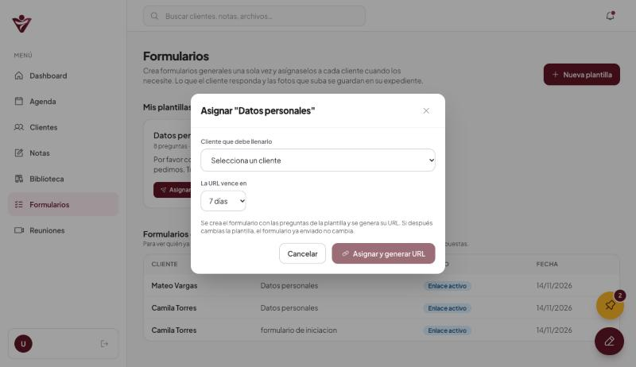
*La ventana para asignar una plantilla.*

1. Elige el cliente que debe llenar el formulario.
2. En cuántos días vence la URL (de 1 a 30).
3. Asignar y generar URL.

El sistema crea el formulario de ese cliente y genera su URL, lista para **Copiar URL** o **Enviar por WhatsApp**.

> **Importante.** **Parejas:** si el cliente es una pareja, el sistema crea **un formulario para cada persona**, cada uno con su propia URL. Cada quien recibe el suyo (el botón de WhatsApp usa el teléfono de esa persona), lo llena por separado y sus respuestas y fotos se guardan en su propio expediente.

### Desde el expediente del cliente

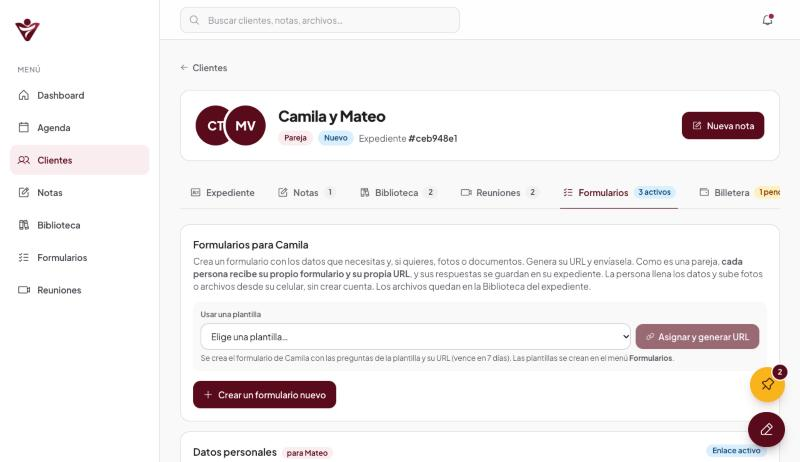
*La pestaña Formularios de un cliente.*

1. Usar una plantilla: elígela y pulsa Asignar y generar URL.
2. Crear un formulario nuevo solo para este cliente.

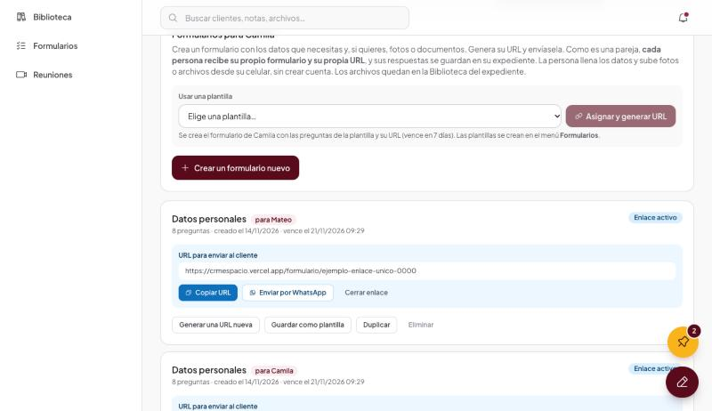
*Un formulario con su URL activa.*

1. En una pareja, cada formulario muestra para quién es.
2. La URL única de este formulario.
3. Copiar URL.
4. Enviar por WhatsApp.
5. Cerrar enlace: deja de funcionar al instante.

- **Generar una URL nueva** reemplaza la anterior y reinicia el vencimiento.
- **Guardar como plantilla** convierte un formulario que ya hiciste en una plantilla reutilizable.
- **Duplicar** (o **Pedir de nuevo**, si ya fue respondido) crea una copia para volver a pedir los datos.

### Qué ve el cliente

Una página sencilla, pensada para el celular, con su primer nombre, las preguntas y un botón **Enviar**. Las preguntas obligatorias llevan un asterisco rojo.

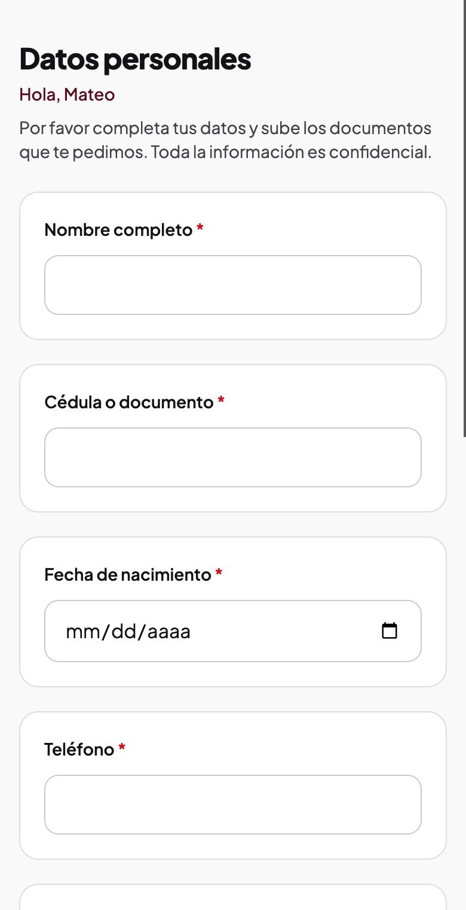
*El formulario en el celular de la persona.*

1. Saluda a la persona por su nombre.
2. Un asterisco rojo indica que la pregunta es obligatoria.

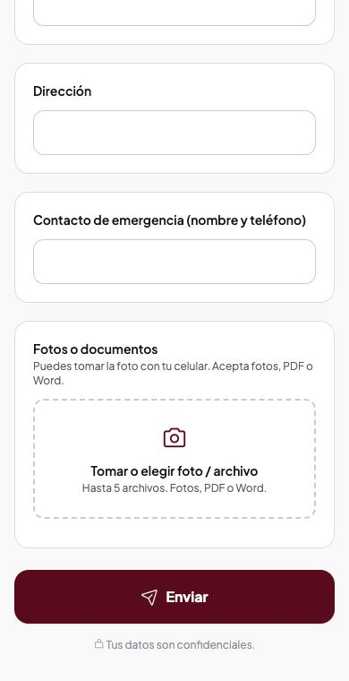
*El final del formulario: subir fotos y enviar.*

1. Tomar o elegir foto o archivo. Las fotos se reducen solas para que suban rápido.
2. Enviar. La persona ve un mensaje de agradecimiento.

- Se aceptan fotos (JPG, PNG, WebP), PDF y Word, de hasta 4 MB cada uno.
- Un formulario se responde **una sola vez**. Si el enlace venció o ya fue enviado, la persona ve un mensaje claro.

### Ver lo que respondió

Cuando la persona envía el formulario, recibes un **correo de aviso** y el formulario pasa a **Respondido**. En el expediente, pestaña **Formularios**, pulsa **Ver respuestas** para leer cada respuesta y abrir los archivos. Los archivos también quedan en la **Biblioteca** del cliente. En el menú **Formularios**, la tabla de seguimiento te muestra de un vistazo quién respondió y quién falta.

## 9. Correos que envía el sistema

Todos salen de la cuenta de correo configurada para EspacioVital, y las respuestas de los clientes llegan a esa misma cuenta.

| Correo | Cuándo se envía |
|---|---|
| Recibimos tu solicitud | Cuando alguien pide una cita desde el sitio web (a la persona). |
| Nueva cita solicitada | A ti, cuando llega una solicitud. |
| Tu cita está confirmada | Cuando confirmas una cita. Incluye fecha, hora, enlace y precio. |
| Tu cita fue cancelada | Cuando cancelas una cita, con el motivo. |
| Factura | Cuando registras un pago. |
| Recordatorio de pago | Cuando pulsas Enviar recordatorio en un cobro. |
| Formulario respondido | A ti, cuando un cliente envía un formulario. |

## 10. Preguntas frecuentes

**No veo la burbuja de recordatorios o el botón de nota.** Recarga la página. En el celular, cierra la pestaña y vuelve a abrirla para que no use una versión guardada.

**La cámara se ve con mala calidad.** Revisa la luz y que las dos personas tengan buena conexión. El sistema usa alta definición, pero el navegador baja la calidad solo si la red es lenta.

**Una persona no se conecta a la videollamada.** Pídele que abra el enlace de nuevo y permita la cámara y el micrófono. Si usa datos móviles, el sistema usa un servidor de apoyo automáticamente.

**El enlace de la reunión dice que expiró.** Los enlaces duran 3 horas. Crea una reunión nueva y envía el enlace nuevo.

**Un cliente no recibe los correos.** Revisa que su correo esté bien escrito en el expediente y pídele que mire la carpeta de spam. Si el correo es provisional (termina en @sin-correo.invalid), edítalo con Editar datos.

**Aparece "Falta: cédula" en una cita.** La persona no escribió ese dato al agendar. Pulsa Editar datos y complétalo.

**Confirmo otra cita de un cliente que ya existe. ¿Se duplica?** No. El sistema reconoce a la persona por su cédula y solo le crea el cobro de la nueva cita.

**No puedo subir un archivo.** Revisa que pese menos de 4 MB. En los formularios se aceptan fotos, PDF y Word.

**Quiero cambiar el precio o los horarios.** Agenda, botón Horarios y precio. Se reflejan en el sitio web al instante.

**El enlace de un archivo dice que venció.** Los enlaces de los archivos duran 24 horas por seguridad. Ábrelo de nuevo desde el expediente.

## 11. Para quien administra el sistema

Esta parte es técnica y no hace falta para el uso diario.

### Piezas del sistema

- **CRM (pantallas):** proyecto `crmespacio` en Vercel.
- **Backend del CRM:** proyecto `backendcrmespaciovital` en Vercel, con la base de datos en Neon y los archivos en Vercel Blob (privado).
- **Motor de citas:** el backend de Florece (proyecto `florece-digitali3`). El CRM le pide las citas y le ordena confirmarlas o cancelarlas.
- **Sitio web:** proyecto `espaciovital`. Su página /agendar pide los horarios y envía las solicitudes al backend de Florece.
- **Videollamadas:** cada llamada va entre navegadores. Un servidor TURN de Cloudflare ayuda cuando una persona está en datos móviles.

### Variables de entorno importantes

| Variable | Dónde | Para qué |
|---|---|---|
| DATABASE_URL, BLOB_READ_WRITE_TOKEN | Backend del CRM | Base de datos y archivos |
| CRM_API_KEY | Backend del CRM y Florece (mismo valor) | Permite que el CRM hable con Florece |
| MAIL_USER, MAIL_PASS, MAIL_FROM_NAME, MAIL_NOTIFY_TO | Backend del CRM y Florece | Cuenta de correo que envía y recibe los avisos |
| CLOUDFLARE_TURN_KEY_ID, CLOUDFLARE_TURN_API_TOKEN | Backend del CRM | Servidor de apoyo para videollamadas |
| CRM_URL | Backend del CRM | Dirección del CRM, para armar los enlaces de reuniones y formularios |
| FLORECE_API_URL | Backend del CRM | Dirección de Florece |
| API_URL | Backend del CRM | Dirección del backend, para armar los enlaces de archivos |

Después de cambiar una variable en Vercel hay que hacer **Redeploy** del proyecto.

> **Importante.** **Pendientes de seguridad.** Hoy las pantallas y la API del CRM no exigen inicio de sesión obligatorio. Existe un trabajo de seguridad preparado (inicio de sesión con token y llave de servicio) que aún no se ha publicado. Se recomienda publicarlo antes de usar el sistema con datos sensibles reales, y rotar la contraseña de la base de datos y el token de Blob, que estuvieron en un archivo de ejemplo del repositorio.

**Índices de la base de datos.** El archivo `sql/indices.sql` del backend crea índices que mantienen las consultas rápidas cuando crezcan los datos. Se ejecuta una vez en el SQL Editor de Neon y es seguro repetirlo.
